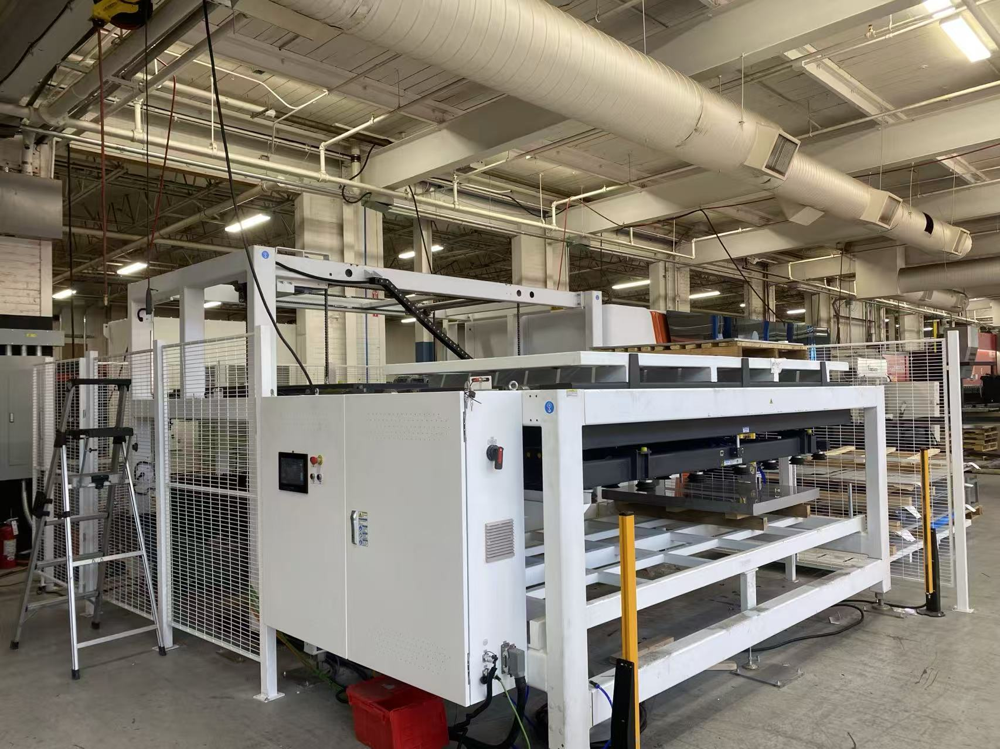
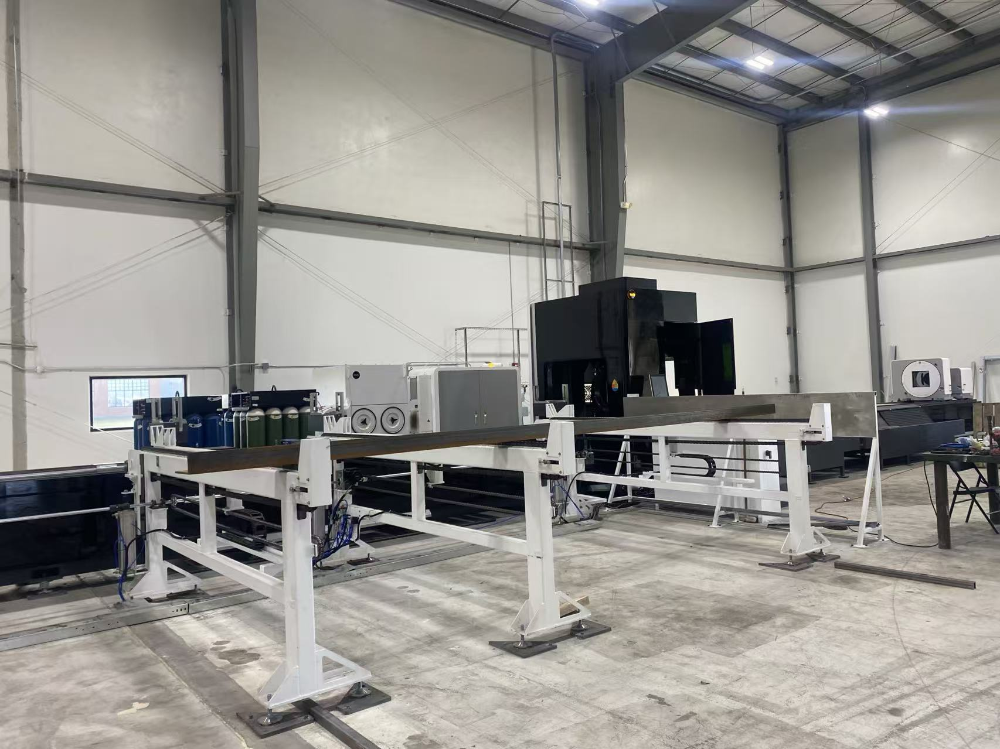

# Welcome to my website

I'm Yongyi Jiang.

This is my personal portfolio.

I'm a Customer Service Engineer with 3+ years of hands-on experience supporting customers through equipment installation, 
commissioning, troubleshooting, maintenance, and operator training. Installed and commissioned 50+ automated fiber-laser 
cutting systems. Skilled in diagnosing mechanical, electrical, pneumatic, PLC/HMI, motion-control, and optical issues; explaining 
technical findings to customers; and coordinating with global R&D to resolve equipment problems. Holds a master's degree in 
Mechanical Engineering, with controlled-environment service experience and semiconductor manufacturing knowledge. 

# Machines I worked on
## Automated Sheet Laser

## Automated Tube Laser

# Subsystems I worked on

# What I do exactly at work:

# Installation

# Commissioning

# Troubleshooting

# Projects I work on outside of work

